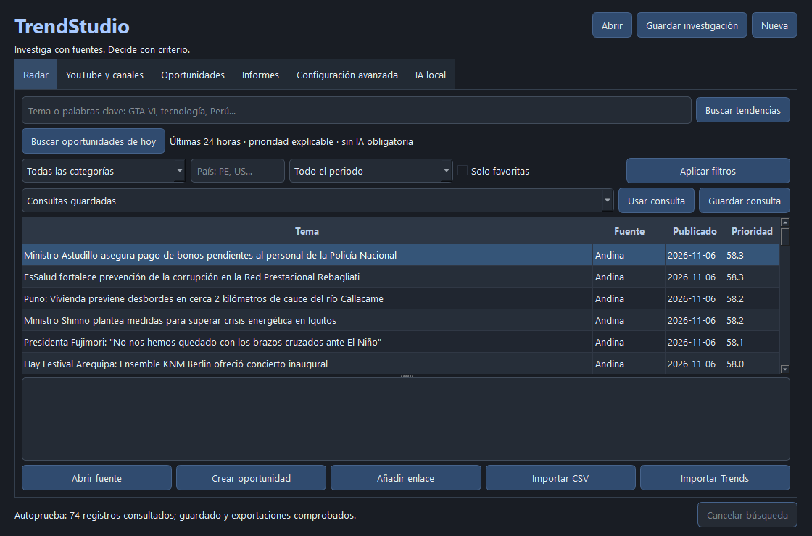

# TrendStudio · beta 1.1

**Radar de oportunidades y analizador de contenido para Windows 11, con IA local opcional.**

Investiga noticias, revisa fuentes, compara canales y prepara ideas para guiones. Interfaz nativa PySide6 en español y modo oscuro. Sin ChatGPT, APIs de OpenAI, suscripciones, servidores externos propios ni modelos nuevos. El radar, los archivos y los informes funcionan sin Ollama.



## Descargar y abrir

Descarga **TrendStudio-Windows-x64.zip** desde [GitHub Releases](https://github.com/javier14-ui/TrendStudio/releases). Extrae toda la carpeta y abre **TrendStudio.exe**. Conserva `_internal` junto al ejecutable. No requiere Python externo ni administrador. Es una distribución para PC Windows 11 x64; no se ofrece una versión separada para laptop.

Para crear un acceso directo en el escritorio, ejecuta `Crear-acceso-directo.ps1` desde la carpeta extraída. El script no sobrescribe accesos existentes. El binario no tiene firma de editor.

## Flujo de trabajo

1. Pulsa **Buscar oportunidades de hoy**: consulta RSS, aplica las últimas 24 horas y ordena por prioridad explicable.
2. Ajusta país, categoría y palabras clave. Selecciona una noticia para ver fuentes, fechas, procedencia, señales y datos faltantes.
3. En **YouTube y canales**, consulta la API opcional, RSS público por ID de canal o metadatos oEmbed de un enlace.
4. En **IA local**, detecta los modelos instalados y analiza una noticia o hasta seis resultados visibles.
5. Crea una oportunidad, revisa los borradores y registra notas, enfoque, evaluación y estado.
6. Guarda la investigación y pulsa **Preparar para guion** para generar un paquete JSON local y versionado.

## Qué incluye

| Función | Alcance real |
|---|---|
| Radar | BBC Mundo, Andina, NASA y PlayStation Blog; añadir/quitar fuentes, favoritos, categorías, país, fechas y palabras clave |
| Priorización | Actualidad, dominios citados e interés observable con pesos configurables; no predice viralidad |
| Acontecimientos | Agrupación aproximada de titulares; conserva los registros originales |
| YouTube | Data API opcional sin activar facturación, hasta 25 videos; RSS público limitado y oEmbed sin clave |
| TikTok | Metadatos públicos oEmbed cuando el endpoint los devuelve; sin estadísticas inventadas ni búsqueda masiva |
| Instagram | Enlaces y CSV manuales; no se presupone acceso a APIs restringidas |
| Google Trends | CSV autorizado de interés a lo largo del tiempo; primera serie, índice relativo 0–100 |
| Canales | Fechas, duración, frecuencia en la muestra, palabras recurrentes y vistas acumuladas/día de antigüedad |
| Ollama | Resumen, clasificación, agrupaciones sugeridas, patrones, títulos, ganchos, enfoques y pendientes de verificar |
| Organización | Consultas, canales, investigaciones recientes, notas y siete estados editoriales |
| Exportaciones | JSON, CSV, HTML local, contrato CreatorStudio y paquete para guion |

Las noticias recientes no equivalen a tendencias demostradas. Los datos manuales se identifican como tales. País y categoría de RSS describen la configuración de la fuente, no una clasificación semántica garantizada de cada noticia.

## IA local: límites visibles

Se reutilizó **llama3.2:1b**, ya instalado en Ollama (1.321.098.329 bytes). No se descargó ni redistribuye ningún modelo. La aplicación solo llama a `127.0.0.1:11434`, procesa una tarea de IA a la vez, limita el contexto y solicita descargar el modelo de la memoria al terminar cada etapa (`keep_alive: 0`). No inicia ni reconfigura el servicio Ollama.

El modelo de 1B es pequeño y puede equivocarse, traducir mal, repetir frases o confundir entidades. Por eso la versión se publica como **beta**. Se validan estructura e identificadores de fuente; las afirmaciones se conservan como citas literales comprobables en los extractos o se sustituyen por los titulares originales, identificados como tales. Se filtran cifras nuevas y enlaces generados en los campos revisados. Esto **no es una verificación semántica ni una garantía de veracidad**.

Las sugerencias repetidas o sin respaldo pueden sustituirse por plantillas editoriales claramente marcadas **no IA**. Los resúmenes, títulos y posibles contradicciones siguen siendo borradores que requieren revisión humana. La IA no lee videos ni artículos completos: recibe títulos, extractos y datos observados.

## Privacidad y almacenamiento

Configuración, caché, historial opcional y clave cifrada: `%LOCALAPPDATA%\TrendStudio`. Investigaciones e informes: la carpeta que elijas. Clave YouTube protegida con DPAPI de Windows, fuera de las exportaciones. La clave no se incluye en URLs ni en archivos públicos. No hay telemetría ni consultas periódicas. Al cerrar TrendStudio terminan sus tareas; Ollama es una aplicación independiente que ya existía en el PC.

Caché HTTP: TTL predeterminado de 30 minutos, máximo 200 archivos. Caché IA: 24 horas, máximo 40 análisis. No se eliminan investigaciones automáticamente. Al alcanzar el límite se dejan de crear nuevas entradas de caché; las consultas siguen funcionando. Limpiar caché e historial es una acción explícita del usuario. Los modelos no se copian dentro de la distribución.

## Desarrollar y compilar

Probado con Python **3.14.4 x64**, PySide6 Essentials **6.12.0** y PyInstaller **6.22.3**. Reutiliza un entorno compatible existente o crea uno local:

```powershell
py -3.14 -m venv .venv
.\.venv\Scripts\python -m pip install -r requirements-dev.txt
.\.venv\Scripts\python run.py
.\.venv\Scripts\python -m pytest -q
```

Compila con `scripts/build.ps1`. Admite `-PythonPath` para reutilizar otro entorno y `-DistPath` / `-WorkPath` para elegir las carpetas. `TrendStudio.spec` evita incluir DLL de ICU ajenas encontradas en PATH: Windows 11 suministra las requeridas. No se modifica Windows ni se instala un runtime global.

Pruebas reales voluntarias (consultan internet y, con `--ollama`, el modelo local):

```powershell
.\.venv\Scripts\python scripts/verify_services.py --ollama --out resultado-servicios.json
.\dist\TrendStudio\TrendStudio.exe --verify-install verificacion.json --live
```

El código está organizado en `core.py` (archivos, HTTP, RSS/API), `research.py` (prioridad, conectores públicos y comparación), `intelligence.py` (Ollama y controles), `app.py` (Qt) y `secrets.py` (DPAPI).

## Documentación y limitaciones

- [Manual de usuario](docs/MANUAL.md)
- [IA local y verificación](docs/IA_LOCAL.md)
- [Contrato JSON de intercambio](docs/INTERCAMBIO.md)
- [Informe de pruebas ejecutadas](docs/PRUEBAS.md)
- [Changelog](CHANGELOG.md)
- [Licencias y atribuciones](THIRD_PARTY_NOTICES.md)

YouTube Data API no se probó con credenciales reales: requiere una clave propia opcional. El RSS público de YouTube puede estar vacío o fallar; no se eluden restricciones. oEmbed no ofrece un radar global de TikTok ni métricas de rendimiento. Instagram necesita importación manual en esta versión. No se descarga contenido audiovisual. Los límites de fuentes y APIs se muestran sin reintentos automáticos masivos. No hay PDF integrado; el HTML puede imprimirse desde el navegador.

Código propio bajo MIT. Qt/PySide y otras dependencias mantienen sus licencias incluidas. Los contenidos de los medios pertenecen a sus titulares. Proyecto independiente: no modifica VozStudio AI ni implementa CreatorStudio.
